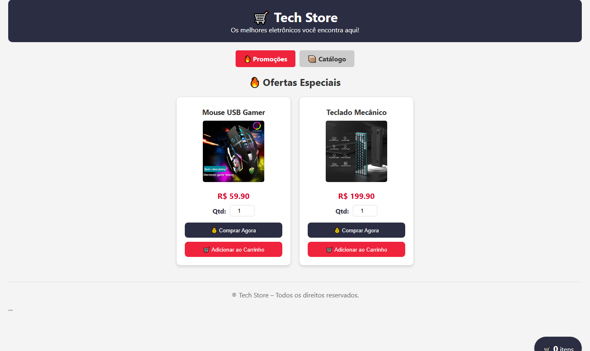

# 🛒 Modelo Site de Vendas — GRJM

## Sistema web de e-commerce

🏆 **Projeto campeão do Módulo 1 da INCODE (2025).**

O **Modelo Site de Vendas GRJM** é um e-commerce web criado pela equipe GRJM para demonstrar uma experiência de compra online de produtos de informática: catálogo, seleção de quantidade, ações de compra e carrinho.

> Este é o repositório institucional do projeto. A versão final do sistema, com o código-fonte e os arquivos da entrega, está preservada no repositório técnico da equipe.

---

## 📸 Sistema em funcionamento

*Tela principal: vitrine de ofertas, preços, quantidade, compra imediata, adição ao carrinho e acesso ao catálogo.*

## 🎯 O desafio

Criar uma experiência de e-commerce clara e funcional para a apresentação de produtos de informática, permitindo ao usuário explorar ofertas e iniciar uma jornada de compra diretamente pela interface web.

## 💡 A solução

O sistema foi construído como uma vitrine digital de eletrônicos com uma interface comercial completa:

- Catálogo de produtos de informática;
- Cards com imagem, nome e preço;
- Controle de quantidade por produto;
- Botões de compra imediata e adição ao carrinho;
- Indicador de itens no carrinho;
- Navegação entre promoções e catálogo;
- Interface visual responsiva e orientada à experiência de compra.

## 🛠️ Tecnologias

Camada | Tecnologias
--- | ---
Interface | HTML5, CSS3 e JavaScript
Execução local | Node.js e `serve`
Proposta | Sistema web de e-commerce

## 🔗 Repositório da versão final

A entrega final do projeto pode ser consultada e executada a partir do repositório técnico:

➡️ [MODELO_SITE_VENDAS.GRJM — versão final](https://github.com/JuniorDdev/MODELO_SITE_VENDAS.GRJM)

## 👥 Equipe GRJM

| Integrantes |
| --- |
| Domingos Junior |
| José Gabriel |
| Milton |
| Rachel Façanha |

## 🏅 Reconhecimento

| Conquista | Instituição | Ano |
| --- | --- | --- |
| Campeão do Módulo 1 | INCODE | 2025 |

---

Desenvolvido pela equipe **GRJM** para a INCODE, 2025.
