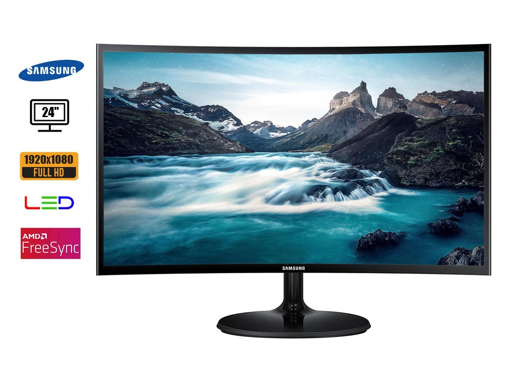
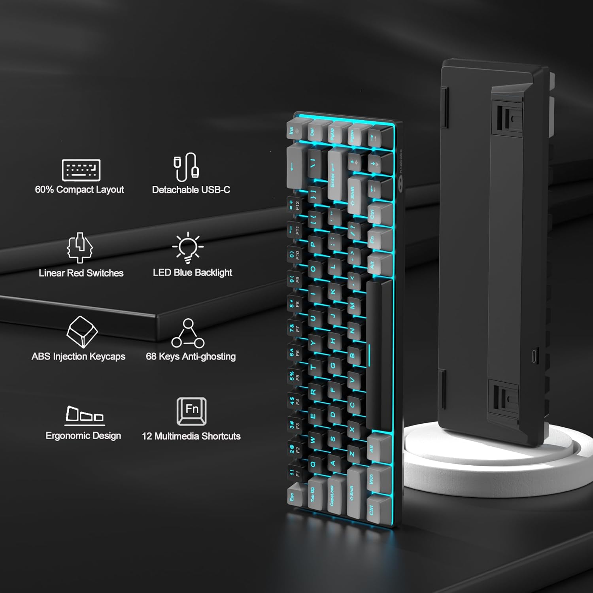

# 🛒 Modelo Site de Vendas — GRJM

Vitrine digital de produtos de informática criada pela equipe GRJM.

🏆 **Projeto campeão do Módulo 1 da INCODE (2025).**

> Este repositório é o showcase institucional do projeto. A versão final da aplicação está preservada no repositório técnico da equipe.

---

## 🎯 A proposta

O **Modelo Site de Vendas GRJM** foi desenvolvido para apresentar um catálogo de produtos de informática de forma visual, organizada e acessível. A solução demonstra os fundamentos de uma experiência de compras online: produtos em destaque, identidade visual e navegação pensada para uma vitrine digital.

## 💡 A solução

Uma aplicação web estática que reúne:

- Catálogo visual de periféricos e componentes de informática;
- Página de apresentação comercial desenvolvida com HTML, CSS e JavaScript;
- Imagens de produtos que reforçam a experiência de vitrine;
- Estrutura simples para demonstração local com Node.js.

## 📸 Destaques do catálogo

| Componentes e performance | Periféricos e experiência |
| --- | --- |
|  |  |
| Kit AMD | Monitor de 24 polegadas |
|  |  |
| Teclado mecânico | Mouse gamer |

## ✨ Tecnologias

Camada | Tecnologias
--- | ---
Interface | HTML5, CSS3 e JavaScript
Execução local | Node.js e `serve`
Conteúdo visual | Catálogo de imagens de produtos

## 🔗 Projeto original

A versão final completa, com código-fonte, estilos e arquivos visuais da entrega, pode ser consultada aqui:

➡️ [Acessar o repositório técnico — MODELO_SITE_VENDAS.GRJM](https://github.com/JuniorDdev/MODELO_SITE_VENDAS.GRJM)

## 👥 Equipe GRJM

### Domingos Junior

### José Gabriel

### Milton

### Rachel Façanha

## 🏅 Reconhecimento

| Conquista | Instituição | Ano |
| --- | --- | --- |
| Campeão do Módulo 1 | INCODE | 2025 |

---

Desenvolvido pela equipe **GRJM** para a INCODE, 2025.
